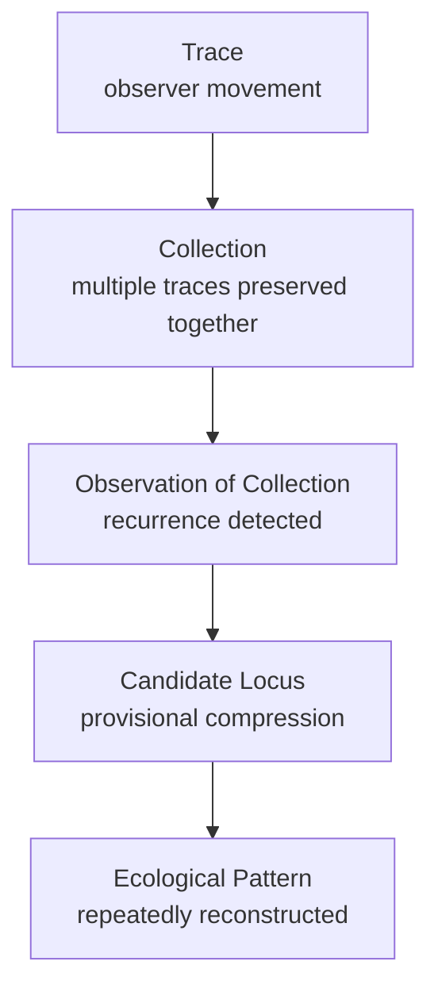

# Documentation and ingress in an Operational Ecology

## Record status and provenance

This record preserves an existing OE definition supplied as an epistemic reference for the operational-method investigation. It is not a new definition authored by this investigation.

The source account is retained below as a distinct reference. Interpretations and control distinctions developed during the present investigation are recorded separately, so they are not silently attributed to the source definition.

---

## Source definition: the role of documentation and ingress

The role of documentation and ingress in an OE project is to preserve reconstructability of the ecology across observer positions and across time. Neither is a deliverable. Neither is external to the work. Both are **surfaces of the ecology itself** — the means by which the ecology can be re-entered, traversed, and reconstructed.

### The role of documentation

Documentation is the **preservation surface** of the ecology. It is not a description of the ecology from outside. It is the surface through which the ecology's traces are preserved so that future observers can re-enter the positions from which the work was produced.

Documentation is not:
- A summary of conclusions
- A deliverable to be handed off
- A narrative of what happened
- A record of the final state

Documentation is:
- A collection of traces
- A preservation surface
- A reconstruction substrate
- Part of the ecology

The ecology is not preserved in the observer's head. It is preserved in the traces the observer leaves behind. If the traces are lost, the ecology cannot be re-entered. If the traces are flattened into conclusions, the ecology cannot be reconstructed — only the conclusions can be repeated.

Documentation preserves the distinctions that made the conclusions visible, not just the conclusions themselves. It preserves provenance, observer position, rejected alternatives, hysteretic trajectories, and unresolved questions.

| Preserved | Not preserved |
|---|---|
| Distinctions | Conclusions in isolation |
| Provenance | Final states |
| Observer position | Narratives of what happened |
| Rejected alternatives | What was assumed |
| Hysteretic trajectories | Static snapshots |
| Unresolved questions | Settled answers |
| Reconstruction pathways | Prescriptions for what to do next |

### Documentation hierarchy

Documentation is a **Collection of Traces**. It is not a Locus or a Pattern. The Locus and the Pattern emerge from observing the collection, not from the documentation itself.

### The role of ingress

Ingress is the **entry surface** through which a different observer position can access the ecology. It is not a summary, a table of contents, or a prescribed reading order.

Ingress is:
- A way of entering
- A surface of access
- A position-specific entry point
- Part of the documentation

Ingress is not:
- A single entry point
- A prescribed sequence
- A summary of the whole
- A destination

Different observers have different purposes, prior knowledge, and continuation questions. A single entry point forces every observer through the same path, which collapses the ecology's topology into a linear sequence.

Ingress preserves the non-linear nature of the ecology. It allows an observer to enter from the position that matches their purpose, rather than being led through a sequence that may not serve them.

Candidate ingress points:

| Ingress | Function |
|---|---|
| Operational | Enter through current state and next steps |
| Provenance | Enter through decision history and rejected alternatives |
| Methodology | Enter through distinctions and invariants |
| Reconstruction | Enter through artifacts and observer position |
| Continuation | Enter through the entry prompt for the next session |

These are parallel entry points, not sequential steps.

### Documentation and ingress together

Documentation is the preservation surface. Ingress is access to that surface. They are not the same thing, but they are inseparable.

Documentation without ingress is a surface with a single entry point — a book that must be read from the beginning. Ingress without documentation is an entry point with nothing to enter — a door with no room behind it.

Together, they form the reconstruction substrate of the ecology:

| Component | Function |
|---|---|
| Documentation | Preserves the traces |
| Ingress | Provides the access |
| Together | Enable reconstruction from different observer positions |

An observer can enter from a position matching their purpose, reconstruct the ecology from traces, re-enter previously occupied positions, continue work, and preserve the distinctions that made conclusions visible.

### Mermaid as a topology representation

Mermaid diagrams are an appropriate form for documenting ingress topology. They can preserve a graph with typed nodes, typed edges, labels, cycles, branches, edge types, and boundaries rather than imposing a sequence.

The Mermaid source is the semantic artifact. The rendering is for human consumption. The source is what the agent reads; the rendering is what the human sees.

### Common structure

| Element | Manifestation |
|---|---|
| Observer position | Where the observer enters from |
| Trace | A record of movement |
| Collection | Multiple traces preserved together |
| Locus | A recurrent feature |
| Pattern | A compressed description of recurrence |
| Re-entry | Transformed participation within a transformed topology |
| Preservation | Reconstruction of the conditions under which the ecology becomes visible |

Re-entry transforms the observer and the topology. Documentation and ingress are not the same thing, but they are engaged through the same discipline.

### Stabilized statement

The role of documentation is to preserve the traces of the ecology so that future observers can reconstruct the observer positions from which the work was produced. The role of ingress is to provide multiple entry surfaces so that different observers can enter the ecology from positions that match their purposes.

Documentation is not a deliverable. It is a preservation surface. Ingress is not a summary. It is a set of access points. Together, they form the reconstruction substrate of the ecology.

Neither documentation nor ingress is external to the ecology. Both are surfaces of the ecology itself. They are the means by which the ecology can be re-entered, traversed, and reconstructed.

---

## Distinctions established in the present investigation

The following are applications and extensions made during this investigation. They are not represented as verbatim elements of the source definition.

### Representation and presence

A representation of an ecological function does not establish that the function is present.

- A file named `INGRESS.md` is not necessarily an ingress surface.
- A `traces/` directory does not guarantee preservation of observer movement or provenance.
- A checkpoint does not guarantee that observer position can be reconstructed.
- Multiple links do not necessarily provide meaningful position-specific entry.
- A Mermaid graph does not preserve topology merely because it contains nodes and edges.

Repository structures must be evaluated by whether they actually support the ecological function they represent.

### Trace, locus, and pattern

A trace records movement. A collection preserves multiple traces. Observation of that collection may reveal recurrence. A candidate locus is a provisional compression of that recurrence. A pattern is a compression that can be repeatedly reconstructed.

These levels must not be collapsed. In particular, a single observed event is not sufficient grounds to declare a pattern.

### Traversal control distinctions

The present investigation has distinguished three criteria, which operate at different levels:

| Criterion | Reference position | Function |
|---|---|---|
| Sufficiency | Current traversal | Triggers re-entry when enough has been preserved to support another pass. It is not completeness. |
| Adequacy | Current traversal, evaluating the proposed next hop | Determines whether that next movement is supportable. Failure of adequacy stops the traversal. |
| Completeness | External observer position, in relation to the external anchor | Adjudicates whether the investigation has fulfilled its purpose. It is not established by the participating observer merely reaching the end of a pass. |

A traversal can be incomplete yet sufficient for re-entry. It can be sufficient to re-enter while a proposed next hop is inadequate. Completeness is adjudicated separately from the external observer position against the external anchor.

---

## Application to this investigation

The investigation of the procedure used in the Android Mainline Port translation project is itself an OE. The translation project is the primary terrain under investigation; it is not identical to the new OE.

The documentation and ingress definition is an epistemic anchor for establishing the new OE. It is to remain available across sessions so that foundational distinctions are not repeatedly rediscovered, flattened, or silently redefined.

The first structural elaboration in this investigation became recursively dominant: attention shifted from the procedure being investigated to the repository architecture intended to contain the investigation. Reintroducing the OE definition restored the distinction between ecological function and its representation.

This observation is retained as an investigative trace, not promoted here to a general pattern or rule.
